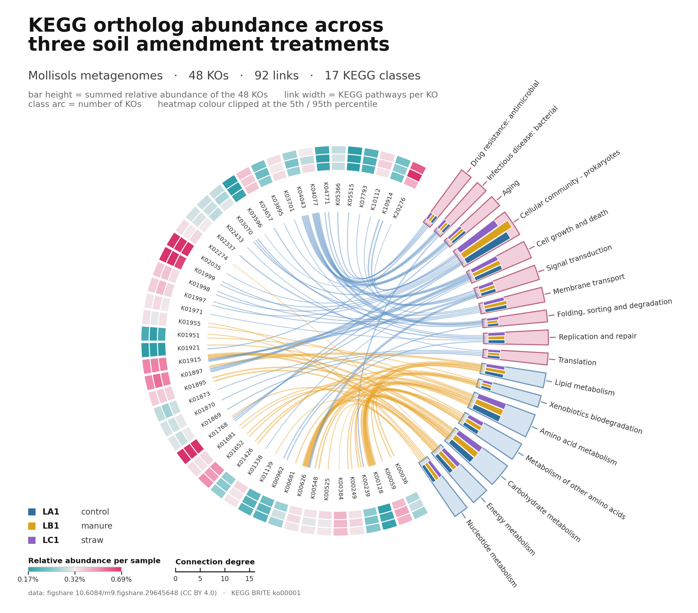
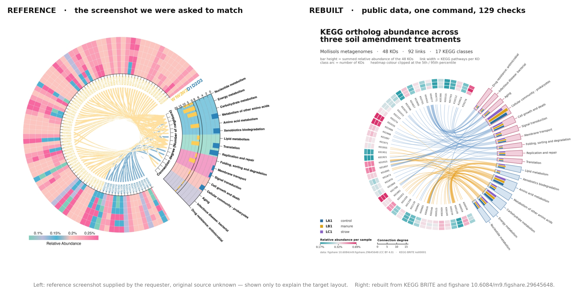
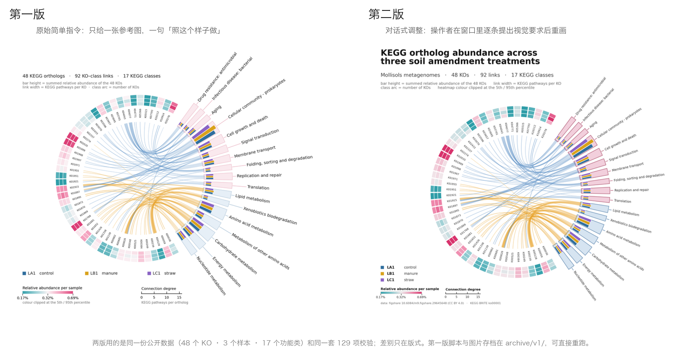
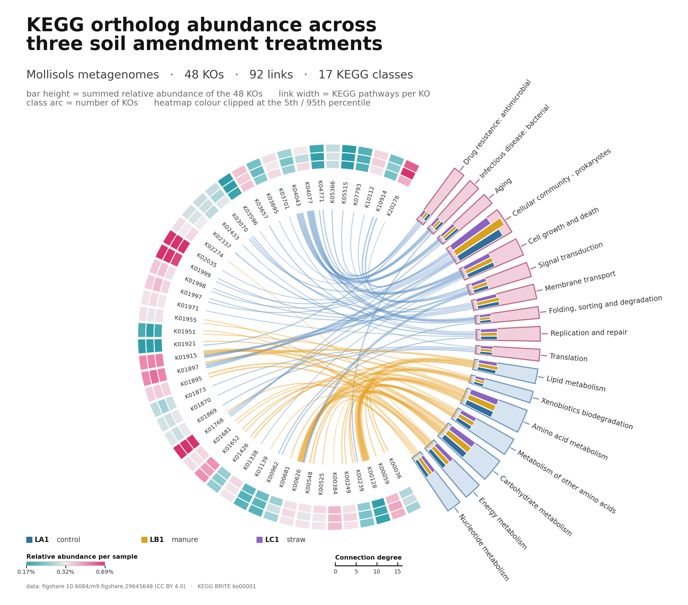
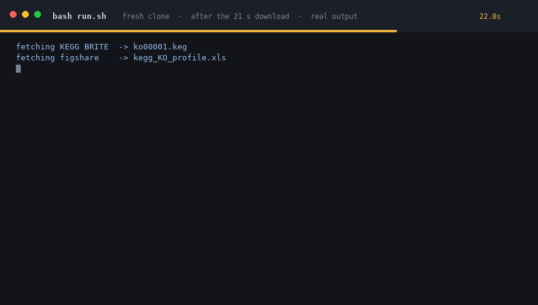

# KEGG ortholog circos plot — reproducible demo

> **这不是论文配图，是ScienceGuru绘图能力演示。** 图里的数字是真的、可以复核；本轮演示的是「理解用户给到的参考图，根据公开数据做一张可复现的图片」，不是一个研究结论。

操作者给的全部输入，是一张截图：没有数据、没有代码、没有出处说明，指令目标原文「我需要一些数据做scienceguru 来做出这样的图,  用于我做为运营 录屏演示scienceguru的能力我的电脑硬件资源有限, 麻烦你根据现有条件去自己完成这个任务.
需要交付给我一个可以作用于完整呈现证明这时候你自己做出这张图片的记录数据 代码 等等素材, 我会把它发布发到git 」。
这张图就是那次任务的最终产物——期间全由ScienceGuru从零找公开数据、写渲染器、写校验，得出第一版后根据自然语言优化命令重画。



> 这是 ScienceGuru 最终交出的成品：根据参考图，为演示目的自动抓取到的公开数据信息为数据基础而算出来的 KEGG 环状图——48 个 KO、3 个样本、17 个功能类。下图为参考图与成品的并排对比。



左边是参考图，右边是本仓库跑出来的图。两者不是像素级临摹：数据源不同、样本数不同，还有几处
刻意做的可读性调整（见「与原图的关系」）。这里要证明的不是「画得像」，而是**同一类图能不能用公开数据
可复现地重做一遍，并且每个步骤与数据都能复核,并根据人的自然语言指令做出对应理想修改**。

## 两轮：原始指令 vs 对话微调



**第一轮**的输入只有一张参考截图和简单目标需求指令。ScienceGuru 自己去找数据、写渲染器、写校验，
产出了左边那一版——内容已经是对的，版式不行。

**第二轮**操作者没有改一行代码，只在窗口里用自然语言逐条提要求：编号排布、字号层级、淡粉对比度、
图例位置、画布比例。每一条都被翻译成代码里的一个常量，重画，对比，再调。

| 项目 | 第一版 | 第二版（本仓库成品） |
|---|---|---|
| 功能类标签 | 8.2pt 粗体、双层交错避开压字 | 细体 5.8pt、单层放射 |
| 功能类轨道 | `#FBE8ED`，对比度 1.17:1 | `#F2CFDC`，1.43:1，描边 3.86:1 |
| 样本图例 | 横排铺满底部 | 竖排放在左下空白 |
| 画布 | 正方形，坐标靠手调 | 按内容包围盒自动拟合 |
| 数据与校验 | 48 个 KO / 129 项 | 同一份，校验项数不变 |

第一版的脚本与图片存档在 `archive/v1/`，`python3 archive/v1/02_plot_circos_v1.py` 可直接重跑，
图像与当时逐字节一致。

<details>
<summary>可选：第二轮进行到一半时的中间版</summary>



画布自动拟合、两级标题、新的轨道对比度、径向 KO 编号——这些已经改好；但样本图例仍是横排、
整块按 2/3 缩放，功能类标签仍是粗体双层。此后才把图例调到 0.78、样本竖排到左下、标签换成细体单层。

这一版只留下图像（`archive/mid/`），当时的代码状态没有单独存档，无法逐字节重跑——放它进来是为了让
两轮之间不是一步跳跃。

</details>

## 30 秒复现



干净克隆后执行 `bash run.sh`：前 21 秒下载两个数据源，随后 8 秒建表、出图、跑完 129 项校验。
上面这段是**真实执行的终端输出按 1.2× 回放**（下载段已跳过），不是演示动画——每一行的数字都来自那次运行。

## 这张图在说什么

| 层 | 视觉元素 | 编码的数据 |
|---|---|---|
| 最外圈热图 | 3 圈色块，每圈一个样本 | 48 个 KEGG ortholog 在 LA1 / LB1 / LC1 三个样本中的相对丰度（%） |
| 内圈连线 | 黄 / 蓝曲线 | 每个 KO 连到它所属的 KEGG 功能类；线宽 = 该 KO 参与的 KEGG 通路数（connection degree，0–16） |
| 右侧弧 | 淡色轨道 + 3 根柱 | 每个功能类被选中的 KO 丰度之和；外圈三条细弧是样本配色 |

黄色 = KEGG 一级类「Metabolism」，蓝色 = 其余四个一级类。

## 数据来源

1. **功能类归属**：KEGG BRITE `ko00001`（KO → pathway class 层级），`https://rest.kegg.jp/get/br:ko00001`。
   脚本每次运行时重新抓取，抓取时间与 sha256 记录在 `data/provenance.json`。
   KEGG 数据的版权归 Kanehisa Laboratories，学术用途。
2. **KO 丰度**：figshare `10.6084/m9.figshare.29645648.v1`，标题 *KEGG KO abundance_Mollisols MR SR CT*，
   授权 **CC BY 4.0**。原始表 94 列 × 9437 个 KO，样本名 = 采样点字母 + 处理字母 + 重复号
   （A = 单施化肥对照，B = 施有机肥，C = 秸秆还田）。

本图使用同一采样点 L 的三个处理：**LA1（control）、LB1（manure）、LC1（straw）**。
没有任何模拟值：`data/provenance.json` 里 `simulated_values` 为 `false`。

## 版式与可读性（第二版优化重做）

画布按 1.2:1 重新定比例，标题两级、关键文字加粗，配色对比度实测如下（WCAG 相对亮度比，白色底）：

| 元素 | 颜色 | 对比度 |
|---|---|---|
| 功能类轨道 · Metabolism | `#D6E4F1` 填充 / `#6F94B8` 描边 | 1.29 : 1 / 3.18 : 1 |
| 功能类轨道 · 其他 | `#F2CFDC` 填充 / `#B96A82` 描边 | 1.43 : 1 / 3.86 : 1 |
| 热图中点 | `#F1EBED` | 1.18 : 1（原为 `#FAF4F6`，1.09 : 1，几乎不可见） |

第一版的淡粉填充只有 1.17 : 1，在白底上等于没有形状，现已改到 1.43 : 1 并加 3.9 : 1 的描边。

## 复现

```bash
bash run.sh          # 抓数据 → 建表 → 出图 → 校验
```

单独运行：

```bash
python3 code/01_prepare_data.py   # 下载 + 解析 + 生成三张中间表
python3 code/02_plot_circos.py    # 渲染 output/figure.{png,svg,pdf}
python3 code/03_verify.py         # 129 项一致性检查，失败即非零退出
```

依赖：Python 3.9+、matplotlib（`pip install -r requirements.txt`）。**不需要 R、不需要 circlize、不需要 GPU、不联网也能重画**
（第一次运行会下载两个原始文件，之后离线可重复）。

## 数据处理的两条规则

1. **相对丰度**：每个样本内，以「落在图中 17 个功能类里的 4138 个 KO」的计数总和为分母，换算成百分比。
2. **KO 选取**：每个功能类取均值丰度最高的 4 个 KO，合并去重后按丰度截取 48 个，最后按 KO 编号排序
   （对应原图按编号排布的观感）。规则写在 `01_prepare_data.py` 的常量里，改一行即可换一种选法。

## 校验做了什么

`code/03_verify.py` 共 129 项断言，全部通过才算成功，包括：

- 原始文件 sha256 与 `provenance.json` 记录一致（数据没被悄悄替换）
- 48 个 KO 都能在 KEGG BRITE 与 figshare 原始表中同时找到
- `ko_links.tsv` 的每一行、每个功能类的 `n_links`、每个 KO 的 `classes` 列互相吻合
- 每个功能类的三样本合计 = 其成员 KO 丰度之和（误差 < 1e-4）
- 三份图像文件确实写出且非空

## 与原图的关系

| | 参考图 | 本仓库 |
|---|---|---|
| 数据来源 | 未公开的原始矩阵 | KEGG BRITE + figshare（DOI 可查） |
| 样本 | 参考图标注 W1 / W2 / D1 / D2 / D3 | 3 个（同一位点的对照 / 有机肥 / 秸秆） |
| KO 数量 | 约 40 | 48 |
| 功能类 | 17 个 KEGG 二级类 | 同 17 个 |
| 可复现性 | 无 | `bash run.sh`，图像逐字节一致 |

**结构是对齐的**：外圈按 KO 排布的热图、内圈「KO → 功能类」的弦图、右侧按类汇总的柱状图，三层一一对应；
连线颜色仍按 Metabolism（黄）/ 其余（蓝）区分。**内容不是照抄的**，因为原始矩阵从未公开。

有意不同的地方，每一条都写在代码常量里：

- KO 编号沿半径排列。参考图沿弧线切向排，48 个编号在切向会互相压字；编号带与热图之间留 0.018 个坐标单位空隙，渲染时自动自检。
- 功能类标签统一细体，只比编号大 1pt。参考图这组字比 KO 编号大得多，视觉上会抢走数据。
- 样本配色改为深蓝 / 琥珀 / 紫，避开热图的青—粉渐变，否则「粉色柱子」和「粉色高值格子」会被读成同一个意思。
- 功能类轨道填充从 1.17:1 提到 1.43:1 对比度并加 3.86:1 描边——原来的淡粉在白底上几乎看不出形状。
- connection degree 标尺从弧线移到左下角直线刻度，避免与连线重叠。
- 颜色标尺按 5%–95% 分位截断、中点设在样本中位数，截断事实写在图上，不做隐藏。
- 画布由程序按内容包围盒自动拟合；比例、字号、配色、图例缩放都是文件顶部常量，改一个数字即可重排。
## 文件

```
code/01_prepare_data.py   抓取、解析、生成 data/processed/*.tsv
code/02_plot_circos.py    单文件渲染器（matplotlib，386 行）
code/03_verify.py         一致性校验
data/raw/                 figshare 原始表（KEGG 快照由 run.sh 抓取，不随仓库分发）
data/processed/           ko_selected.tsv / ko_links.tsv / class_summary.tsv
data/provenance.json      来源、授权、sha256、推导说明
output/figure.png|svg|pdf
assets/                   参考图、两版对比图、30 秒复现 GIF
archive/v1/               第一版的脚本与图片（可重跑）
archive/mid/              第二轮中途的图像（仅图像，不可重跑）
run.sh                    一键复现

```

## 许可与引用

- **代码与图**：MIT，见 `LICENSE`。
- **figshare 数据**：CC BY 4.0，随仓库分发。引用时请保留出处：Hou，*KEGG KO abundance_Mollisols MR SR CT*，
  figshare，DOI 10.6084/m9.figshare.29645648。
- **KEGG 数据**：版权归 Kanehisa Laboratories，限学术用途。因此 `data/raw/ko00001.keg` 不随仓库分发，
  由 `run.sh` 每次重新抓取；若 KEGG 更新了该文件，`03_verify.py` 会因 sha256 变化报警——那是数据源变了，不是图错了。
- **参考图**（`assets/reference.jpg`）：需求方提供的截图，原始来源不明，仅用于说明目标图式，不属于本仓库的成果；
  若权利人认为不妥，删除该文件即可，不影响其余内容。
